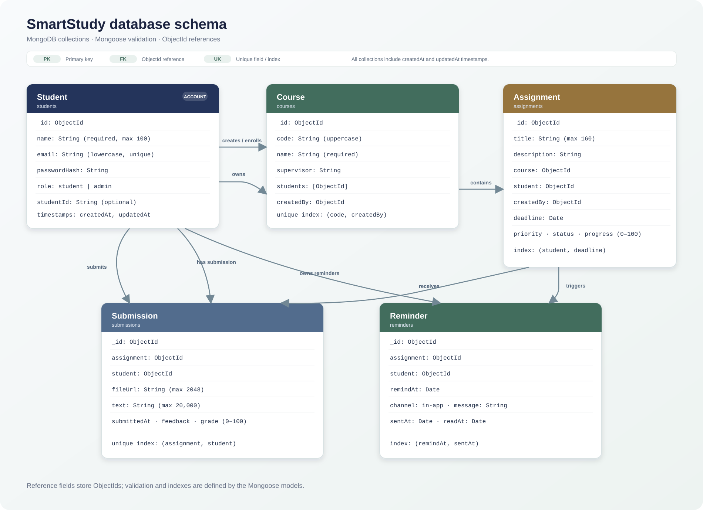

# SmartStudy ER diagram

MongoDB stores each entity as a collection; ObjectId references implement the relationships. A course can be associated with multiple students through its `students` reference array. The models and indexes are in `models/`.
