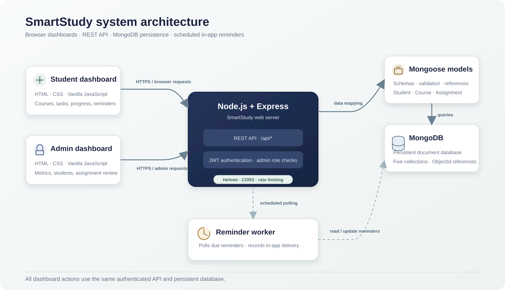
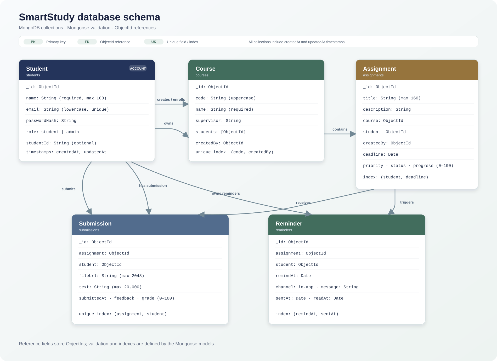

# SmartStudy — Study Planner and Assignment Tracker

## Project Report

**Course Code:** Project 300

**Submitted by**

| Student name | Student ID |
|---|---|
| Md Fuad Hasan Raj | 232-115-096 |
| Anjum Tabassum Anta | 232-115-102 |

**Faculty:** Md Shamihul Islam Khan Limon

<!-- pagebreak -->

## 1. Project overview

SmartStudy helps students organize courses, track assignment deadlines and progress, submit their work, and schedule reminders. It is made with an HTML, CSS, and JavaScript frontend, a Node.js and Express backend, and a MongoDB database accessed through Mongoose.

## 2. Objectives and scope

The project is intended to:

- Organize course and assignment information for each student.
- Make deadlines, priorities, and assignment progress visible.
- Let students submit assignment text or a link to their work.
- Let students schedule and manage in-app reminders.
- Give administrators aggregate activity information and tools to review assignments and student accounts.

The prototype accepts assignment URLs and text; it does not upload files or provide email/SMS reminders. Administrator account creation is handled through the seed script, not public registration.

## 3. Technology stack

| Layer | Technology | Use |
|---|---|---|
| Frontend | HTML5, CSS3, vanilla JavaScript | Student and administrator dashboards |
| Runtime | Node.js 18 or newer | JavaScript server runtime |
| Web/API | Express 4 | Static files and REST endpoints |
| Database | MongoDB | Persistent application records |
| Data layer | Mongoose 8 | Schemas, validation, references, and queries |
| Authentication | JSON Web Token (JWT) | Bearer-token authentication |
| Password security | bcryptjs | Password hashing |
| HTTP security | Helmet, CORS policy, express-rate-limit | Response headers, cross-origin configuration, and API request limiting |
| Testing | Node.js test runner, Supertest, mongodb-memory-server | API integration tests with an ephemeral MongoDB |

## 4. System architecture



The Express application serves the student interface at `/` and the administrator interface at `/admin.html`, as well as the `/api` endpoints. Protected endpoints require a JWT bearer token. Administrator routes additionally require the `admin` role. Mongoose models validate and map application records to MongoDB collections.

## 5. Functional requirements

### 5.1 Student functions

1. Register with a name, email, optional student ID, and password.
2. Log in and retrieve the authenticated account profile.
3. View a dashboard summary of courses and assignments.
4. Create, list, update, and delete courses.
5. Create assignments with a course, priority, and deadline.
6. View assignments sorted by deadline.
7. Search tasks and filter them by priority and status.
8. Change assignment status and track progress from 0 to 100 percent.
9. Submit assignment text and/or an HTTP(S) URL; a successful submission marks the assignment complete.
10. Create, list, mark as read, and delete in-app reminders.

### 5.2 Administrator functions

1. Log in with an account whose role is `admin`.
2. View counts of students, courses, assignments, submissions, and overdue assignments, plus assignment counts by status.
3. List student names, email addresses, student IDs, and account creation dates.
4. Review assignments with student and course details; update deadlines, priorities, and statuses.
5. Remove a student account, while preventing deletion of the active administrator account.

## 6. Database design

MongoDB stores five application collections corresponding to the Mongoose models. Relationships are represented by MongoDB ObjectId references.



### 6.1 Collections and validation

| Collection / model | Main fields and rules | Relationships and indexes |
|---|---|---|
| `students` — `Student` | `name` required, maximum 100 characters; normalized unique `email`; required `passwordHash`; role is `student` or `admin`; optional `studentId`. Timestamps enabled. | Referenced by courses, assignments, submissions, and reminders. Email has a unique index. |
| `courses` — `Course` | Required uppercase `code`, required `name`, optional `supervisor`, array of enrolled student references, required `createdBy`. Timestamps enabled. | Unique compound index on `(code, createdBy)`. A course may have assignments and multiple enrolled students. |
| `assignments` — `Assignment` | Required title (maximum 160 characters), optional description, required course/student/creator references, required deadline; priority is `Low`, `Medium`, or `High`; status is `Pending`, `In Progress`, or `Completed`; progress is 0–100. Timestamps enabled. | Index on `(student, deadline)` to support a student's deadline-ordered assignment list. |
| `submissions` — `Submission` | Required assignment and student references; optional URL (maximum 2048 characters) and text (maximum 20,000 characters); submission time, optional feedback, and grade from 0–100. Timestamps enabled. | Unique compound index on `(assignment, student)`, so the student's submission for an assignment is updated rather than duplicated. |
| `reminders` — `Reminder` | Required assignment and student references and reminder time; channel is `in-app`; message, sent time, and read time are tracked. Timestamps enabled. | Index on `(remindAt, sentAt)` for the reminder worker's due-reminder lookup. |

Every model file is in `models/`. The same schema diagram is also maintained in [ER_DIAGRAM.md](./ER_DIAGRAM.md).

## 7. API reference

Protected endpoints require `Authorization: Bearer <JWT>`. Routes under `/api/admin` additionally require an administrator role.

| Method | Endpoint | Access | Purpose |
|---|---|---|---|
| `GET` | `/api/health` | Public | Check that the API is responding. |
| `POST` | `/api/auth/register` | Public | Register a student; password must contain at least 8 characters. |
| `POST` | `/api/auth/login` | Public | Authenticate and return a JWT and user profile. |
| `GET` | `/api/auth/me` | Authenticated | Get the current account profile. |
| `PATCH` | `/api/auth/me` | Authenticated | Update the account name and/or student ID. |
| `GET` | `/api/courses` | Authenticated | List courses created by or associated with the current account. |
| `POST` | `/api/courses` | Authenticated | Create a course. |
| `PATCH` | `/api/courses/:id` | Authenticated, owner | Update course name or supervisor. |
| `DELETE` | `/api/courses/:id` | Authenticated, owner | Delete a course. |
| `GET` | `/api/assignments` | Authenticated | List assignments; students see their own, administrators see all. |
| `POST` | `/api/assignments` | Authenticated | Create an assignment for an accessible course. |
| `PATCH` | `/api/assignments/:id` | Authenticated, owner or admin | Update assignment details, status, deadline, priority, or progress. Completed status sets progress to 100. |
| `DELETE` | `/api/assignments/:id` | Authenticated, owner or admin | Delete an assignment and its reminders. |
| `GET` | `/api/assignments/:id/submissions` | Authenticated, owner or admin | List submission record(s) for an assignment. |
| `POST` | `/api/assignments/:id/submissions` | Authenticated, assignment student | Create or update a submission using text and/or an HTTP(S) URL. |
| `GET` | `/api/reminders` | Authenticated | List the current student's reminders. |
| `POST` | `/api/reminders` | Authenticated | Schedule a reminder for the student's assignment at a future time. |
| `PATCH` | `/api/reminders/:id/read` | Authenticated, owner | Mark a reminder as read. |
| `DELETE` | `/api/reminders/:id` | Authenticated, owner | Delete a reminder. |
| `GET` | `/api/admin/overview` | Admin | Return aggregate counts and assignment status totals. |
| `GET` | `/api/admin/students` | Admin | List student account summaries. |
| `DELETE` | `/api/admin/students/:id` | Admin | Remove a student account, except the active admin. |
| `GET` | `/api/admin/assignments` | Admin | List all assignments with student and course details. |
| `PATCH` | `/api/admin/assignments/:id` | Admin | Update an assignment deadline, priority, or status. |

## 8. User interface

### Student dashboard

The student UI is served from `index.html`. It includes registration/login, an overview dashboard, course management, task search/filtering, assignment creation, status and progress controls, assignment submission, reminders, and profile editing. Client-side scripts are in `js/` and styling is in `css/style.css`.

### Administrator dashboard

The administrator UI is served from `admin.html`. It provides role-checked login, aggregate statistics, a student list with account removal, and an assignment table for deadline/status review. The dashboard calls the administrator API endpoints rather than using local-only sample data.

## 9. Security and data handling

- Passwords are stored as bcrypt hashes; plaintext passwords are not stored in the database.
- Authenticated API requests use signed JWT bearer tokens with a seven-day expiry.
- Administrator endpoints use a role check in addition to authentication.
- Student assignment, submission, reminder, and course actions are scoped to records they are permitted to access.
- Submission URLs are restricted to `http` and `https`; empty submissions are rejected.
- Helmet, a configurable CORS origin, a JSON request-size limit, and API rate limiting are enabled.
- Configure a strong, unique `JWT_SECRET` and a restricted production `CLIENT_ORIGIN` before deployment.
- Seed credentials are for local demonstration only. Do not expose them in a deployed environment.

## 10. Installation and operation

### Prerequisites

- Node.js 18 or newer and npm.
- MongoDB Community Server running locally, or a MongoDB Atlas connection string.

### Configure and start

1. Install dependencies with `npm install`.
2. Copy `.env.example` to `.env`.
3. Configure `MONGODB_URI`, a strong `JWT_SECRET`, and `CLIENT_ORIGIN`.
4. Run `npm run seed` to create the development admin and demo records.
5. Start the server with `npm start` (or `npm run dev` for nodemon).
6. Open `http://localhost:3000` for the student dashboard and `http://localhost:3000/admin.html` for the administrator dashboard.
7. Check `http://localhost:3000/api/health` for the API health response.

### Seeded demo accounts

The seed script creates an administrator and three student accounts. All three demo students have two courses and two assignments each.

| Account | Email | Student ID | Seeded password |
|---|---|---|---|
| Administrator | `admin@smartstudy.local` | — | `Admin12345!` |
| Avery Rahman | `avery.rahman@demo.smartstudy.local` | `DEMO-1001` | `Student12345!` |
| Samira Chowdhury | `samira.chowdhury@demo.smartstudy.local` | `DEMO-1002` | `Student12345!` |
| Rafi Hasan | `rafi.hasan@demo.smartstudy.local` | `DEMO-1003` | `Student12345!` |

`DEMO_STUDENT_PASSWORD` can override the shared demo-student password for a seed run. The seed script resets the seeded administrator password to the default development password whenever it runs; do not rerun it in an environment where that reset is undesirable. The script upserts demo courses and assignments, so rerunning it does not duplicate those seeded records.

## 11. Test evidence

Run the automated integration suite with:

```text
npm test
```

The suite uses `mongodb-memory-server` and Supertest to exercise the API without requiring the application's persistent MongoDB instance. The verified run completed **6 tests: 6 passed, 0 failed**. Coverage includes:

- Student registration, course and assignment creation, progress changes, and reminder scheduling.
- Administrator role restrictions and overview/student data.
- Health endpoint, student/admin dashboard files, and frontend task script serving.
- Submission validation, recording, and completion behavior.
- Reminder time validation, listing, read marking, and deletion.
- Administrator assignment updates and completion progress behavior.

## 12. Known limitations

- Reminders are in-app records; the worker logs due reminders and sets their sent state. Email, SMS, push, and browser notification delivery are not implemented.
- Assignment file uploads are not implemented; work is submitted as text and/or an HTTP(S) URL.
- Student deletion does not cascade-delete related courses, assignments, submissions, or reminders.
- Course deletion does not currently cascade-delete associated assignments.
- Seeded names, IDs, courses, supervisors, and passwords are demonstration data, not verified institutional records.
- The database does not currently implement a dedicated password-change endpoint.

## 13. Main project files

| Path | Responsibility |
|---|---|
| `server.js` | Express setup, middleware, API routing, MongoDB connection, and reminder worker startup. |
| `routes/` | Authentication, course, assignment/submission, reminder, and administrator endpoints. |
| `models/` | The five Mongoose schemas and database indexes. |
| `middleware/auth.js` | JWT authentication and administrator role enforcement. |
| `services/reminderWorker.js` | Polling and processing of due in-app reminders. |
| `index.html`, `admin.html` | Student and administrator interfaces. |
| `js/`, `css/` | Client-side behavior and styles. |
| `scripts/seed.js` | Development administrator and demo-data seeding. |
| `tests/` | API integration tests. |
| `docs/ER_DIAGRAM.md` | Standalone ER diagram and model relationship summary. |
